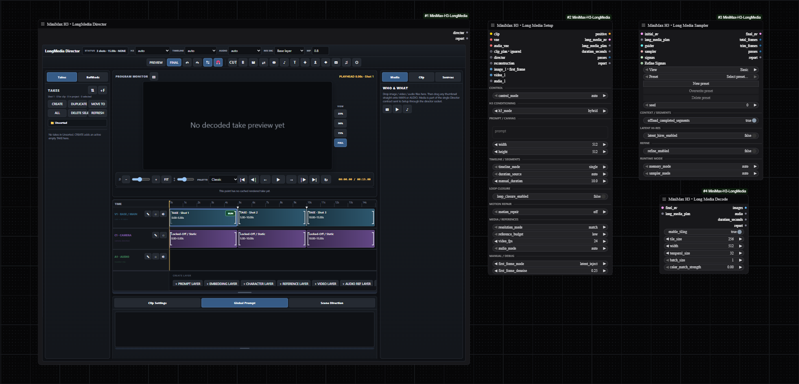

# ComfyUI-MiniMax-H3-LongMedia

Production-oriented ComfyUI nodes для **MiniMax H3**: long-form video/audio generation, native reference editing, Director timeline authoring, MultiClip planning, camera direction, segmentation, lip-sync/redubbing, latent hi-res refine, reconstruction и adaptive low-VRAM execution.



**Текущий релиз: 0.6.69.**

## Что изменилось после публичной версии 0.6.63

- **Частичный MultiClip RUN:** готовые клипы можно оставить замороженными и добавить новые без предварительного TAKE для новых целей. При ошибке чтения кеша запуск останавливается вместо неявного полного рендера.
- **Range и Bridge:** перегенерация диапазона между CUT-маркерами и генерация моста между совместимыми GENERATED-клипами. Результат Bridge остаётся ожидающим до Accept или Discard.
- **Совместимость с ComfyUI:** новая H3 VAE сохраняет собственную нарезку кадров и тайлов; после прохода LongMedia исходный output head модели восстанавливается.
- **Аудио и очистка:** lip sync сохраняет полную шкалу Audio 1, включая тишину в начале. Sampler освобождает модели, подготовленные для запуска, и сохраняет исходную ошибку рендера.
- **Sampler и интерфейс:** View расположен над параметрами, действия пресетов вынесены в отдельные кнопки New, Overwrite и Delete, а обновления Director сгруппированы для уменьшения нагрузки на интерфейс.

Подробности и границы проверки — в общем [описании релиза 0.6.69](docs/RELEASE_NOTES_0.6.69_RU.md).

## Документация

- [Русский индекс документации](docs/README_RU.md)
- [English documentation index](docs/README_EN.md)
- [LongMedia Director — полное руководство](docs/DIRECTOR_GUIDE_RU.md)
- [Режимы LongMedia](docs/MODES_GUIDE_RU.md)
- [Режимы аудио и `video_ref_edit`](docs/AUDIO_MODES_GUIDE_RU.md)
- [Integrated Refine и Latent Hi-Res](docs/TWO_PASS_LATENT_HIRES_REFINER_GUIDE_RU.md)
- [Sampler, VRAM и производительность](docs/SAMPLER_OPTIMIZATION_RU.md)
- [Полный справочник параметров узлов и Director](docs/PARAMETER_REFERENCE_RU.md)

## Основные ноды

- **MiniMax H3 • Long Media Setup**
- **MiniMax H3 • Long Media Planner**
- **MiniMax H3 • LongMedia Director**
- **MiniMax H3 • Long Media Cameras**
- **MiniMax H3 • Long Media Sampler**
- **MiniMax H3 • Long Media Decode**
- **MiniMax H3 • Long Media Video Reconstructor**

Legacy `MiniMaxH3LatentLab...` class identifiers остаются зарегистрированными для совместимости старых workflow.

## Установка

Установите в:

```text
ComfyUI/custom_nodes/ComfyUI-MiniMax-H3-LongMedia
```

или через Comfy Registry.

Идентичность package:

```text
GitHub:             vizart-vj/ComfyUI-MiniMax-H3-LongMedia
Comfy PublisherId:  noise
```

После установки/обновления перезапустите ComfyUI.

## Текущая semantic model Setup

Новые workflow используют независимые controls:

```text
control_mode
h3_mode
timeline_mode
duration_source
audio_mode
motion_repair
```

H3 conditioning families:

```text
t2va
fl2va
ref2va
hybrid
video_ref_edit
```

Timeline modes:

```text
single
segmented
multiclip
```

Duration ownership:

```text
auto
video
audio
manual
longest_input
```

См. [Режимы LongMedia](docs/MODES_GUIDE_RU.md).

## LongMedia Director 0.6.69

Director — unified authoring surface для MAIN timing, prompts, WHO & WHAT media, ролей REF/FIRST/LAST, cameras, temporal embeddings, audio policy, resolution policy, Program Monitor и TAKE management.

```text
LongMedia Director
        ↓ director
Long Media Setup  (control_mode=director)
```

Текущее хранилище TAKE — TAKE-centric. CREATE создаёт активный пустой workspace; следующий успешный render заполняет тот же TAKE. Restore атомарно возвращает полный saved Director state.

Начиная с 0.6.54 продолжение формально разделяет `GENERATED` и `MEDIA`: `GENERATED → GENERATED` использует сохранённый native TAKE latent, а `MEDIA → GENERATED` строит свежий H3 target и закрепляет только VAE-encoded tail внешнего видео как native frame-0 `minimax_keyframes` guide. Полный импортированный ролик не становится diffusion target и не проходит full-video VAE roundtrip.

В 0.6.55 добавлены интегрированные в Director RefMods: переиспользуемые native H3 visual/audio references из Director media, выбранного timeline clip или TAKE. RefMods независимы от learned text embeddings и физического TAKE continuation; авторские интервалы управляют видимостью native reference keys на target frame lattice. Audio RefMod — это Audio Reference, без гарантии voice cloning.

См. [полное руководство Director](docs/DIRECTOR_GUIDE_RU.md).

## Integrated Refine / Latent Hi-Res

Одна Long Media Sampler содержит MAIN stage и optional internal Stage 2, включаемый `refine_enabled`. При включённом Refine `windowed_refine` можно выключить, чтобы принудительно выполнить единый full-latent Stage 2 pass для максимальной temporal/lighting continuity.

```text
Stage 1 MAIN x0
    ↓
(optional) learned video-latent upscale
    ↓
Stage 2 Refine using Refine Sigmas
    ↓
final video + exact Stage-1 audio
```

Длинный/high-resolution Stage 2 может работать bounded temporal windows при включённом `windowed_refine`. Refine video-authoritative: Stage-1 audio сохраняется точно и не пересэмпливается как audio refiner.

См. [Integrated Refine и Latent Hi-Res](docs/TWO_PASS_LATENT_HIRES_REFINER_GUIDE_RU.md).

## Sampler / memory

Рекомендуемый старт:

```text
sampler_mode   = auto
memory_mode    = auto
attention_mode = auto
```

Оставляйте ComfyUI Dynamic VRAM включённым. Runtime включает очистку transient CUDA references между повторными Queue, packed-storage-aware quantized AUTO routing, guarded native INT8 residency, exact Existing/Kitchen fallback paths, file-backed Windows loading больших safetensors и безопасный offload Latent Hi-Res model. Явные manual Sampler значения сохраняются в NORMAL/AUTO-normal профилях.

См. [Sampler, VRAM и производительность](docs/SAMPLER_OPTIMIZATION_RU.md).
